# 丹青（DanQing）

**A pure client-side graphics engine for massive BIM / digital-twin models** —
itwinjs-core's large-scale tile streaming and frontend rendering capability,
re-implemented in C++20 with Filament-grade platform layers. Target users:
graphics / CAD application developers.

DanQing is a **reference implementation**: every line of code, naming, and test
is strictly aligned with the reference projects (itwinjs-core / filament /
imodel-native) — no self-invented algorithms, interfaces, data structures, or
constants.

[English](#english) | [中文](#中文)

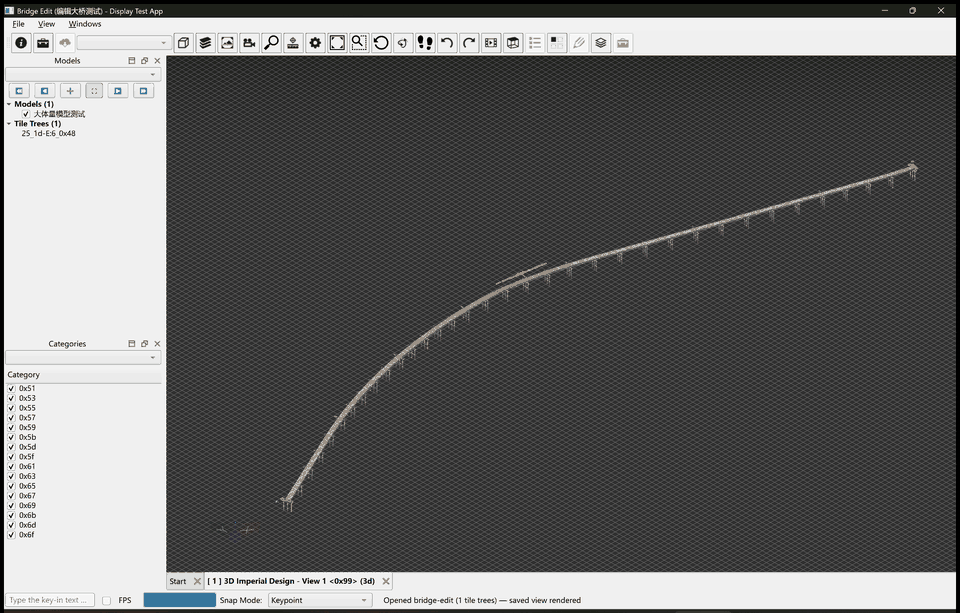

---

## English

### Why DanQing

- **Massive models, smooth interaction** — streams and renders a 380,738-tile
  bridge (5 GB imdl payload) with continuous zoom LOD refinement; a 170k-tile /
  47.9 GB 10-km bridge opens and browses from local tile dumps.
- **Real performance engineering, measured** — every number below is reproduced
  by the in-repo harness (see [Performance](#performance)).
- **Reference-fidelity methodology** — 2,956 automated tests including
  pixel-level regression locks replaying real-backend RPC tile dumps; the
  sample app mirrors itwinjs display-test-app's UI and interaction 1:1.
- **Embeddable SDK** — engine modules `dqBase/dqGeom/dqCommon/dqRender` have
  Qt-free public APIs and build standalone; the Qt desktop app is a host, not a
  dependency. Zero network access in the engine by construction.

### Screenshots & demos

| Streaming zoom into a 1.5 km bridge (LOD refines live) | Sectioning a house model | Rendering Style presets |
|---|---|---|
|  | 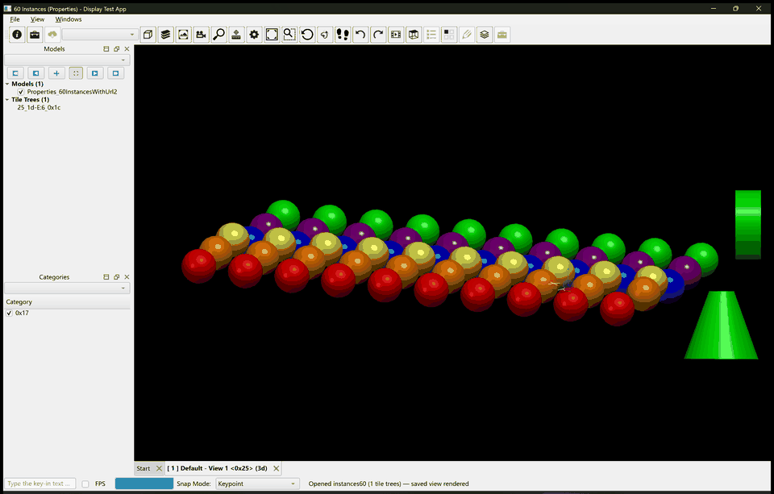 | 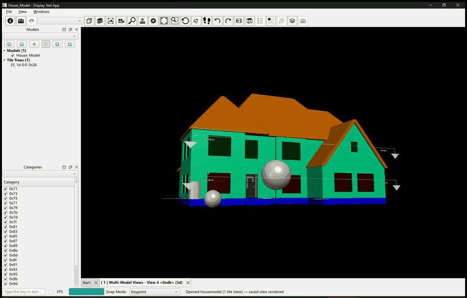 |

| Start page | Joe's House saved view | 60 instanced spheres |
|---|---|---|
| 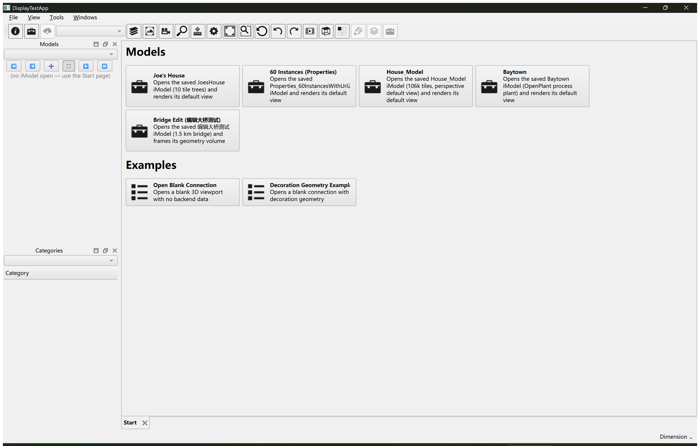 | 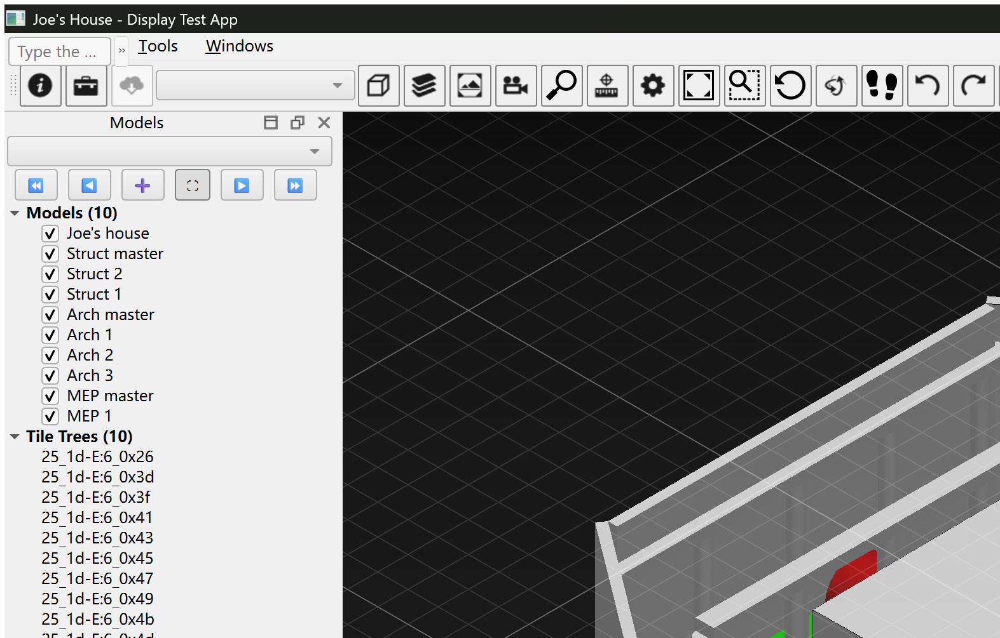 | 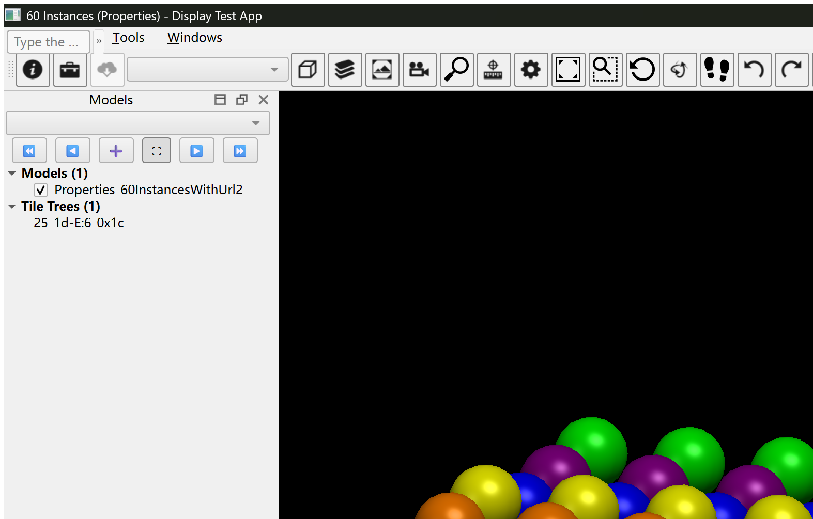 |

The eight demo models (captured from real itwinjs backends — see
[Demo data](#demo-data)):

| | | | |
|---|---|---|---|
| 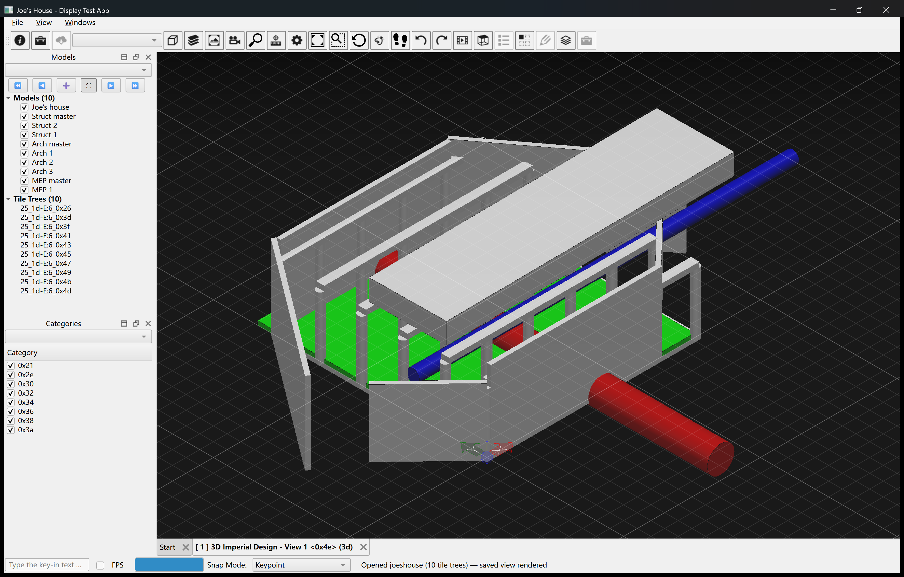 |  | 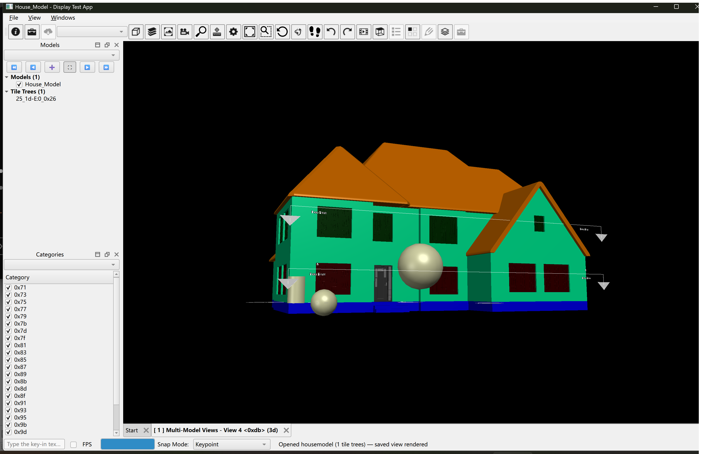 | 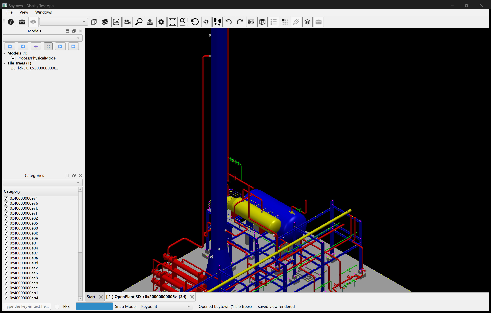 |
| **Joe's House** | **60 Instances** | **House_Model** | **Baytown** |
| 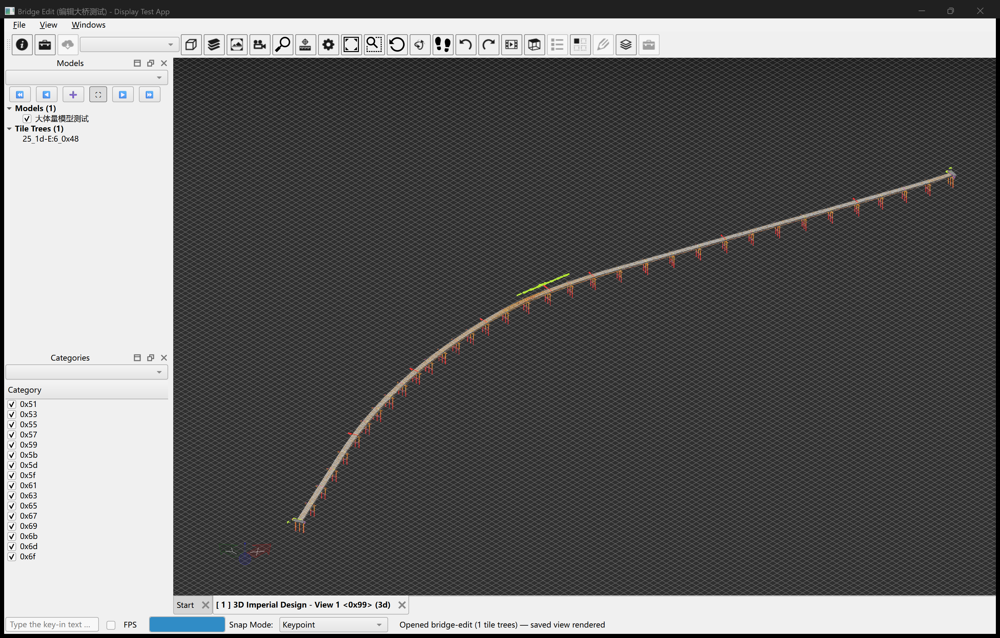 | 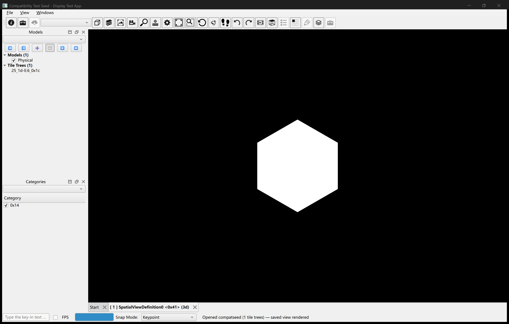 | 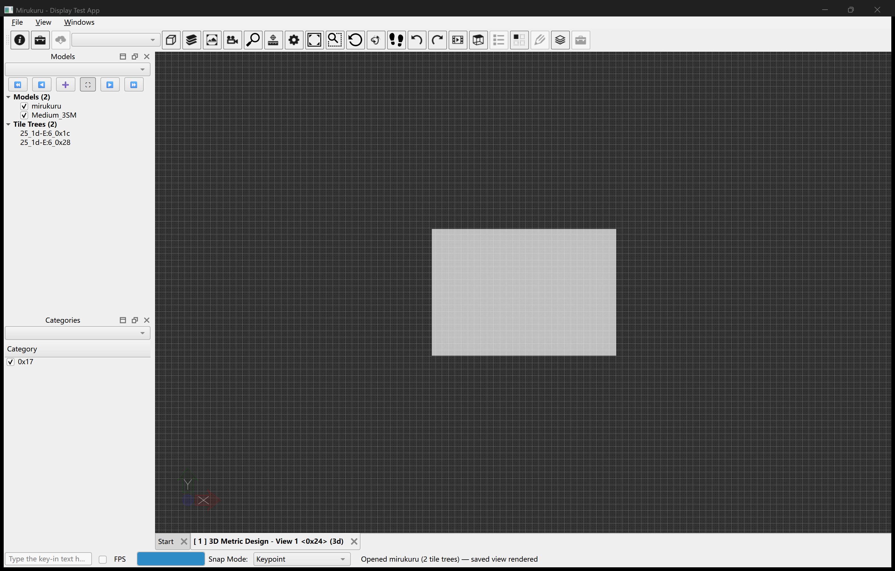 | 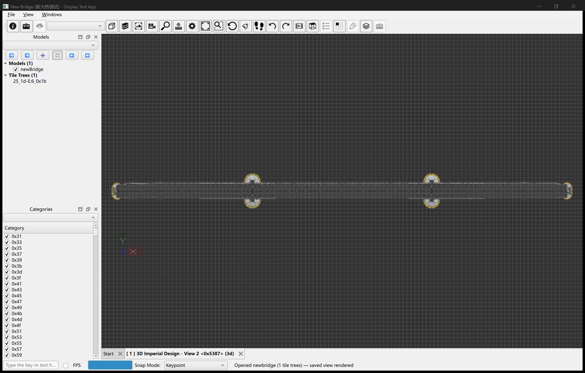 |
| **Bridge Edit** | **Compatibility Test Seed** | **Mirukuru** | **New Bridge** |

### Feature highlights

Rendering & tiles
- Full itwinjs imdl tile pipeline: LOD trees, spatial + magnification children,
  `maxInitialTilesToSkip` skip semantics, empty-subrange masks, multi-tree
  model selectors, `hasMissingTiles` parent fallback.
- GPU vertex-LUT mesh decoding (quantized + unquantized), instanced geometry
  (per-instance transform/color/feature), edge chains
  (segments / silhouettes / indexed / compact), polylines & point strings,
  embedded textures, per-vertex and color-table materials.
- Multi-pass compositor: opaque / translucent WBOIT (order-independent
  transparency), background, sky box, world/screen overlays, hilite pass,
  pick buffers (element-id exact picking + flash/hilite + hover tooltips).
- Viewport 24-step frame pipeline with four-level invalidation cascade;
  async tile loading on worker threads (fetch + imdl parse off the UI thread).

Display & analysis
- 14 rendering-style presets (Illustration / Comic / Moonlit / Schematic …),
  hidden-line styles with edge overrides, monochrome modes, white-on-white
  reversal.
- Thematic display (height / slope / sensor IDW interpolation with GPU sensor
  textures), ambient occlusion (HBAO + blur), sectioning (clip plane / box /
  shape with interactive handles), contours, analysis-style displacement
  channels.
- Solar / schedule / analysis timelines with playback; camera-path recording
  and playback; saved views (create / recall / update / delete, persisted).
- Second-iModel overlay, per-category visibility, feature-override panels,
  measure-distance tool, walk / fly / look-and-move navigation, selection
  (click / box / ctrl-invert), zoom-to-selected.

Developer surface
- itwinjs display-test-app parity UI: 26-item main toolbar, key-in console
  (`dta ...` tools: save image, record fps, output shaders, macro playback,
  tile-tree inspector…), status bar with FPS / tile-load / snap modes.
- `ITileFetcher` / `ITileTreePropsProvider` DI seams: the engine consumes
  bytes; hosts decide where bytes come from (the sample app replays local
  dump packages — zero network by construction).

### Performance

All numbers measured on the same Windows 11 workstation (Release build,
NVIDIA desktop GPU); sources: in-repo pixel-lock harness and the
`DANQING_OPEN_TRACE` / `DANQING_TILE_TIME` / `DANQING_UI_TRACE` diagnostics.

| Scenario | Measurement |
|---|---|
| Open "Joe's House" (173,876-tile package, 278 MB manifest) to first rendered saved view | **0.57 s** (2.87 s before the P-1 pipeline work) |
| Open "60 Instances" | **0.45 s** |
| Open "Bridge Edit" (380,738 tiles available) | **2.0 s** |
| Per-tile feature-table build on the largest tiles (108k features) | **1,635 ms → 48 ms** (O(n²) → O(n log n) port-fidelity fix) |
| UI thread longest stall during a 20-step continuous zoom on the bridge | **≤ 235 ms** (was 10.4 s before async fetch/parse) |
| Zoom / pan with LOD refinement | live in the hero GIF above |

Test gate: **2,956 tests — 2,928 pass, 28 skip (headless-GL family), 0 fail**
(Debug, full suite; 38 dump-driven locks self-skip when the big data packages
are not downloaded — see below).

### Quick start

#### A. Prebuilt demo app (Windows x64, ~5 minutes)

1. Download `DanQing-DisplayTestApp-v0.1.0-win64.zip` from
   [Releases](https://github.com/chenjinxian/DanQing/releases) and extract.
2. (Optional, for the five big models) download data packages from the
   [DanQing-Data](https://github.com/chenjinxian/DanQing-Data) `data-v1`
   release and extract them into `data\rpc-dumps\` next to `run.cmd`.
3. Run `run.cmd`. The four example cards (Blank Connection / Decoration
   Geometry / Cesium gallery / Analysis Style) and the two small models
   (Compatibility Test Seed, Mirukuru — bundled in the repo) work with zero
   data download.

#### B. Build from source

```bash
git clone --depth 1 https://github.com/chenjinxian/DanQing.git
# shallow clone = ~160 MB on disk (source ~21 MB + in-repo small-model data
# 22 MB + newbridge manifests ~60 MB + git pack ~39 MB); full history is
# ~2.3 GiB (it predates the data externalization) — prefer --depth 1
scripts\bootstrap_third_party.ps1   # Qt 6.11.1 via aqtinstall (see notes inside)
cmake -S . -B build -DCMAKE_BUILD_TYPE=Debug
cmake --build build -j --config Debug
ctest --test-dir build -C Debug --output-on-failure
```

- Toolchain: Visual Studio 2022 (v143), CMake ≥ 3.20, Qt 6.11.1
  (`third_party/qt/...` via the bootstrap script; Qt absent → the engine SDK
  libraries still build and their tests run — only dqApp + the sample app are
  skipped).
- GoogleTest is **vendored** at `third_party/googletest` (no submodules —
  everything needed is in the clone).
- To restore the five big demo models:
  `powershell -ExecutionPolicy Bypass -File scripts/data/download_dumps.ps1`
  (downloads → sha256-verifies → extracts into `third_party/tile-sample-assets/rpc-dumps/`;
  `-Model instances60` fetches just one).

### Demo data

The eight demo models are real-backend tile captures (imdl + iModel metadata),
collected with the out-of-repo CDP tooling against itwinjs display-test-app
(MIT) — provenance per package: `third_party/tile-sample-assets/rpc-dumps/README.md`.

| Model | Content | Tiles | Raw size | Where |
|---|---|---|---|---|
| Joe's House | 10-tree residence, edges + color tables | 173,931 | 353 MB | DanQing-Data `joeshouse.zip` |
| House_Model | textured house, perspective saved view | 106,719 | 579 MB | DanQing-Data `housemodel.zip` |
| Baytown | OpenPlant process plant | 81,329 | 849 MB | DanQing-Data `baytown.zip` |
| Bridge Edit | 1.5 km bridge | 381,800 | 5.7 GB | DanQing-Data `bridge-edit-base.zip` + `sweep-part1..3of3.zip` |
| 60 Instances | 60 instanced spheres + placements | 3,595 | 305 MB | DanQing-Data `instances60.zip` |
| Compatibility Test Seed | itwinjs backend test asset | 212 | 21 MB | in-repo (`rpc-dumps/compatseed-sweep-v1`) |
| Mirukuru | V8 bridge, Japanese plane coords, 2-tree open chain | 2 | 2 KB | in-repo (`rpc-dumps/mirukuru-sweep-v1`) |
| New Bridge | 10 km bridge, d1–d13 full tree | 169,920 | 47.5 GB | DanQing-Data `newbridge-*.zip` (v1 + sweep 12 parts = the browsing core; d9–d13 = deep zoom) |

All five big models are also available as a plain git clone (SSH — works without
a proxy): `git clone git@github.com:chenjinxian/DanQing-Data.git`, then point the
app at it with `DANQING_RPC_DUMP=<clone dir>`. Two GitHub-100MB-limit caveats are
listed in that repo's README.

### Modules

| Module | Namespace | Role |
|--------|-----------|------|
| **dqBase** | `dqBase` | Shared foundation (smart pointers, Result, containers, events). Zero domain knowledge, zero Qt |
| **dqGeom** | `dqGeom` | Pure math geometry (curves/surfaces/meshes/topology/clipping/BSpline). Zero solid-kernel dependency |
| **dqCommon** | `dqCommon` | Shared types (ColorDef, ViewFlags, Frustum, FeatureTable, GeometryStream), mirroring @itwin/core-common |
| **dqRender** | `dqRender` | Rendering engine (RHI / Tile system / multi-pass / shaders), mirroring itwinjs core/frontend + filament |
| **dqApp** | `dqApp` | Render host layer (Application / ViewManager / Viewport 24-step pipeline / ToolAdmin; Qt only as host-window bridge) |

`samples/DisplayTestApp` is the demo + pixel-level regression test host (not
part of the SDK).

### Reference projects (read-only, checked out outside this repo)

| Project | Role |
|---------|------|
| **itwinjs-core** | Primary rendering-stack reference: render pipeline, frontend API, Tile system, glTF |
| **filament** | RHI driver, OpenGL backend, authoritative reference for the Windows WGL platform layer |
| **imodel-native** | dqGeom geometry reference |
| **FreeCAD** | Test-host (DisplayTestApp) Gui command framework only |

### Documentation

- **CLAUDE.md** — the single authority for development rules (reference fidelity,
  naming alignment, test provenance, architecture constraints)
- `docs/DanQing-图形引擎架构设计.md` — current architecture description
- `docs/itwinjs-core-渲染系统执行流程分析.md` — full render-pipeline analysis
- `docs/DTA功能对照与专业化分析-2026-09-30.md` — 85-row feature-parity matrix vs
  itwinjs display-test-app
- `docs/DisplayTestApp-模型打开与数据加载说明.md` — model-open / data-loading explainer
- `docs/DanQing-C++代码规范.md` — C++ format rules (subordinate to CLAUDE.md)
- Milestone plan/record docs (`docs/阶段*-实现计划-*.md`) — per-milestone
  forensic records

### License

Apache License 2.0 — see [LICENSE](LICENSE). Portions derived from upstream
projects retain their original licenses — see [NOTICE](NOTICE). Demo data
packages derive from itwinjs sample iModels and are provided for demo/testing
purposes.

---

## 中文

丹青（DanQing）是**纯客户端图形引擎**：itwinjs-core 数字孪生大体量渲染能力 × Filament 高质量实时渲染与全平台能力的共同体（C++20 重实现）。目标用户是图形/CAD 应用开发者。在天工开物平台家族中的分工：渲染层——几何内核归真形（私有仓，自主研发），CAD 应用归鲁班CAD，数据/事务归 imodel-native。

丹青是**参考实现**（reference implementation）：所有代码、命名、测试严格对齐参考项目（itwinjs-core / filament / imodel-native），不自创算法/接口/数据结构/常量。

### 为什么是丹青

- **大体量模型，流畅交互**——38 万瓦级桥梁（5GB imdl）流式加载 + 连续缩放 LOD 实时细化；17 万瓦 / 47.9GB 十公里大桥本地回放浏览。
- **性能工程全部实测**——下表每个数字都可由仓内 harness 复核（见[性能](#性能)）。
- **参考保真方法论**——2956 项自动化测试，含真实后端 RPC dump 回放的像素级回归锁；示例程序与 itwinjs display-test-app 的 UI 与交互 1:1。
- **可嵌入 SDK**——引擎模块 `dqBase/dqGeom/dqCommon/dqRender` 公开 API 零 Qt、可独立构建；Qt 桌面端只是宿主。引擎构造性零网络。

### 截图与演示

| 1.5km 桥梁流式缩放（LOD 实时细化） | 房屋模型剖切 | 渲染样式预设 |
|---|---|---|
|  |  |  |

八个演示模型（真实后端采集，见[演示数据](#演示数据)）：

| | | | |
|---|---|---|---|
|  |  |  |  |
| **Joe's House** | **60 Instances** | **House_Model** | **Baytown** |
|  |  |  |  |
| **Bridge Edit** | **Compatibility Test Seed** | **Mirukuru** | **New Bridge** |

### 功能要点

渲染与瓦系统
- 完整 itwinjs imdl 瓦管线：LOD 树、空间+放大子瓦、`maxInitialTilesToSkip` 跳级语义、空域掩码、多树 modelSelector、`hasMissingTiles` 父瓦兜底。
- GPU 顶点 LUT 网格解码（量化+非量化）、实例化几何（逐实例变换/颜色/特征）、边缘链四形态（segments/silhouettes/indexed/compact）、折线与点串、嵌入纹理、逐顶点色与色表材质。
- 多 Pass 合成器：opaque / translucent WBOIT 次序无关透明、背景、天空盒、world/screen overlay、高亮 pass、拾取缓冲（elementId 精确拾取 + 闪烁/高亮 + 悬停提示）。
- Viewport 24 步帧管线 + 四级失效级联；瓦加载全异步（fetch 与 imdl 解析在 worker 线程）。

显示与分析
- 14 种渲染样式预设（Illustration/Comic/Moonlit/Schematic…）、隐藏线样式与边覆盖、单色模式、白底反白。
- Thematic 显示（高度/坡度/传感器 IDW 插值，GPU 传感器纹理）、环境光遮蔽（HBAO+模糊）、剖切（平面/盒/形状 + 交互手柄）、等值线、Analysis Style 位移通道。
- 日照/进度/分析 Timeline 回放；相机路径录制与播放；Saved Views（建/取/改/删 + 持久化）。
- 第二 iModel 叠加、按类别可见性、特征覆盖面板、测距工具、Walk/Fly/LookAndMove 导航、点选/框选/ctrl 反选、缩放到选中。

开发者面
- 与 itwinjs display-test-app 对齐的 UI：26 项主工具栏、key-in 控制台（`dta ...` 工具族：save image/record fps/output shaders/macro/瓦树检查器…）、状态栏（FPS/瓦装载/捕捉模式）。
- `ITileFetcher`/`ITileTreePropsProvider` DI 缝隙：引擎只消费字节，取数归宿主（示例程序回放本地数据包——构造性零网络）。

### 性能

全部数字同机实测（Windows 11，Release 构建，桌面 NVIDIA GPU）；来源：仓内像素级 harness 与 `DANQING_OPEN_TRACE`/`DANQING_TILE_TIME`/`DANQING_UI_TRACE` 诊断开关。

| 场景 | 实测 |
|---|---|
| 打开 Joe's House（173,876 瓦包，278MB manifest）至 saved 视图上屏 | **0.57s**（P-1 管线化前 2.87s） |
| 打开 60 Instances | **0.45s** |
| 打开 Bridge Edit（380,738 瓦可用域） | **2.0s** |
| 最大瓦特征表构建（108k 特征/瓦） | **1635ms → 48ms**（O(n²)→O(n log n) 保真修复） |
| 桥模型 20 级连续缩放 UI 线程最长停顿 | **≤235ms**（异步化前 10.4s） |
| 缩放/平移 LOD 细化 | 见顶部 hero 动图 |

测试门禁：**2956 项 = 2928 通过 + 28 跳过（headless-GL 族）+ 0 失败**（Debug 全量；未下载大数据包时 38 只 dump 锁自动跳过——见下）。

### 快速开始

#### A. 预编译示例包（Windows x64，约 5 分钟）

1. 从 [Releases](https://github.com/chenjinxian/DanQing/releases) 下载 `DanQing-DisplayTestApp-v0.1.0-win64.zip` 并解压。
2.（可选，五个大模型）从 [DanQing-Data](https://github.com/chenjinxian/DanQing-Data) 的 `data-v1` release 下载数据包，解压到 `run.cmd` 旁的 `data\rpc-dumps\`。
3. 运行 `run.cmd`。四张示例卡片（Blank Connection / Decoration Geometry / Cesium 陈列馆 / Analysis Style）与两个小模型（Compatibility Test Seed、Mirukuru——随仓）零下载即可用。

#### B. 源码构建

```bash
git clone --depth 1 https://github.com/chenjinxian/DanQing.git
# 浅克隆落盘约 160MB（源码 ~21MB + 仓内小模型数据 22MB + newbridge manifests
# ~60MB + git pack ~39MB）；全量历史约 2.3 GiB（数据外置前的旧 pack）——建议 --depth 1
scripts\bootstrap_third_party.ps1   # Qt 6.11.1（aqtinstall；注意事项见脚本内注释）
cmake -S . -B build -DCMAKE_BUILD_TYPE=Debug
cmake --build build -j --config Debug
ctest --test-dir build -C Debug --output-on-failure
```

- 工具链：Visual Studio 2022（v143）、CMake ≥ 3.20、Qt 6.11.1（`third_party/qt/...`，bootstrap 脚本下载；Qt 缺席时引擎 SDK 库仍可构建且测试可跑——只跳过 dqApp 与示例程序）。
- GoogleTest **vendored** 于 `third_party/googletest`（无 submodule——克隆即全）。
- 回灌五个大模型：`powershell -ExecutionPolicy Bypass -File scripts/data/download_dumps.ps1`（下载 → sha256 校验 → 解包到 `third_party/tile-sample-assets/rpc-dumps/`；`-Model instances60` 只取其一）。

### 演示数据

八个演示模型是真实后端瓦采集（imdl + iModel 元数据），采集工具在仓外（CDP 注入 itwinjs display-test-app，MIT）——逐包 provenance 见 `third_party/tile-sample-assets/rpc-dumps/README.md`。

| 模型 | 内容 | 瓦数 | 原始体量 | 获取 |
|---|---|---|---|---|
| Joe's House | 10 树住宅，边缘+色表 | 173,931 | 353 MB | DanQing-Data `joeshouse.zip` |
| House_Model | 纹理住宅，透视 saved 视图 | 106,719 | 579 MB | DanQing-Data `housemodel.zip` |
| Baytown | OpenPlant 工艺厂 | 81,329 | 849 MB | DanQing-Data `baytown.zip` |
| Bridge Edit | 1.5km 桥梁 | 381,800 | 5.7 GB | DanQing-Data `bridge-edit-base.zip` + `sweep-part1..3of3.zip` |
| 60 Instances | 60 实例球 + placements | 3,595 | 305 MB | DanQing-Data `instances60.zip` |
| Compatibility Test Seed | itwinjs 后端测试资产 | 212 | 21 MB | 随仓（`rpc-dumps/compatseed-sweep-v1`） |
| Mirukuru | V8 桥，日本平面坐标，双树打开链 | 2 | 2 KB | 随仓（`rpc-dumps/mirukuru-sweep-v1`） |
| New Bridge | 10km 大桥，d1–d13 全树 | 169,920 | 47.5 GB | DanQing-Data `newbridge-*.zip`（v1 + sweep 12 卷 = 浏览核心；d9–d13 = 深层缩放） |

五个大模型同时支持 git 直克隆（SSH 免代理）：`git clone git@github.com:chenjinxian/DanQing-Data.git`，
用 `DANQING_RPC_DUMP=<克隆目录>` 指向即可；GitHub 100MB 限制导致的两点差异见该仓 README。

### 模块

| 模块 | 命名空间 | 职责 |
|------|---------|------|
| **dqBase** | `dqBase` | 共享基础（智能指针、Result、容器、事件），零领域知识，零 Qt |
| **dqGeom** | `dqGeom` | 纯数学几何（曲线/曲面/网格/拓扑/裁剪/BSpline），零固体内核依赖 |
| **dqCommon** | `dqCommon` | 共享类型（ColorDef、ViewFlags、Frustum、FeatureTable、GeometryStream），对应 @itwin/core-common |
| **dqRender** | `dqRender` | 渲染引擎（RHI/Tile/多 Pass/Shader），对应 itwinjs core/frontend + filament |
| **dqApp** | `dqApp` | 渲染宿主层（Application/ViewManager/Viewport 24 步管线/ToolAdmin；Qt 仅作宿主窗口桥接） |

`samples/DisplayTestApp` 是演示 + 像素级回归测试宿主（非 SDK）。

### 参考项目（仓外只读检出）

| 参考项目 | 角色 |
|---------|------|
| **itwinjs-core** | 渲染栈主参考：渲染管线、前端 API、Tile 系统、glTF |
| **filament** | RHI 驱动、OpenGL 后端、Windows WGL 平台层权威参考 |
| **imodel-native** | dqGeom 几何参考 |
| **FreeCAD** | 仅测试宿主（DisplayTestApp）Gui 命令框架参考 |

### 文档

- **CLAUDE.md** — 开发规则的唯一权威（参考保真、命名对齐、测试溯源、架构约束）
- `docs/DanQing-图形引擎架构设计.md` — 现行架构描述
- `docs/itwinjs-core-渲染系统执行流程分析.md` — 渲染管线全流程分析
- `docs/DTA功能对照与专业化分析-2026-09-30.md` — 与 itwinjs display-test-app 的 85 行功能对照矩阵
- `docs/DisplayTestApp-模型打开与数据加载说明.md` — 模型打开/数据加载说明
- `docs/DanQing-C++代码规范.md` — C++ 格式规范（CLAUDE.md 的从属参考）
- 里程碑计划/实录文档（`docs/阶段*-实现计划-*.md`）——逐里程碑取证台账

### 许可证

Apache License 2.0 —— 见 [LICENSE](LICENSE)。衍生自上游项目的部分保留其原始许可证 —— 见 [NOTICE](NOTICE)。演示数据包派生自 itwinjs 示例 iModel，仅供演示/测试用途。
